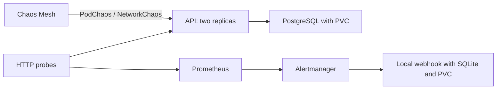

# Chaos Mesh with the notes application

[Português](README.md)

I wanted to see whether the alerts help explain a failure while it is happening. Here, Chaos Mesh removes Pods and changes the network between the notes API and PostgreSQL. Prometheus watches HTTP probes, Alertmanager notifies a local inbox, and the test follows recovery and checks the data.

The application comes from [docker-lab](https://github.com/tommmdl/docker-lab), using the Alpine images already adopted by the portfolio. It gets its own database and volumes in `chaos-demo`. Observation components live in `chaos-observe`, and Chaos Mesh lives in `chaos-system`. Other labs retain their configuration and data.



## Experiments

| Experiment | Question | What to observe |
| --- | --- | --- |
| Remove one API replica | Does its peer keep the service available? | HTTP responses, a replacement Pod UID and no sustained outage alert. |
| Delay API → database by 100 ms per packet | Can the alert distinguish slowness from downtime? | Probe duration above 400 ms, successful probes and `ChaosApiSlow`. |
| Block API → database for 60 s | Does the API stay alive when it loses its dependency? | Healthy liveness, failing readiness and `ChaosDatabaseUnavailable`. |
| Make both API replicas unavailable | Does downtime reach the entire alert delivery chain? | Failed probes, `ChaosApiUnavailable`, firing and resolved webhooks. |
| Remove the PostgreSQL Pod | Does it return with acknowledged writes intact? | A replacement Pod, the same PVC, equal data and a new API write. |

Network and unavailability experiments have bounded durations. The test cancels some through normal resource deletion and lets the network partition expire to verify timed recovery. The controller must remain available to perform that recovery.

In the first local run, abruptly removing one replica produced **2 connection failures in 16 samples**. The other 14 returned 200, and no sustained outage alert fired. This remains in the initial report: replica recovery did not mean an absence of transient errors.

## Run

Use Linux or WSL on x86_64, Docker, Python 3 and the existing `devops-notes` kind cluster from [kubernetes-lab](https://github.com/tommmdl/kubernetes-lab). Keep the repositories side by side. The script uses that lab's kubeconfig and kubectl with an explicit context. Override paths through `KUBECTL` and `KUBECONFIG_CHAOS` when needed.

The kernel needs `sch_netem`. On this computer it was loaded by the WSL root user. On Linux with sudo:

```bash
sudo modprobe sch_netem
python3 scripts/lab.py up
python3 tests/verify.py
python3 scripts/access.py
```

Helm and the chart have pinned versions and checksums in [config/tools.json](config/tools.json). The installer downloads them and verifies hashes before installation. No extra Python packages are needed. CI creates a disposable cluster and uses the same installer and tests.

While `access.py` is running:

- [Application — localhost:8024](http://localhost:8024/)
- [Prometheus — localhost:8025](http://localhost:8025/)
- [Alertmanager — localhost:8026](http://localhost:8026/)
- [Received notifications — localhost:8027/api/events](http://localhost:8027/api/events)

Local access follows Services through NodePorts and survives Pod replacement. It can return errors during faults. Failed writes are never retried automatically; reconcile their outcome before retrying.

## Explore one failure at a time

```bash
python3 scripts/experiment.py apply 02-database-delay
python3 scripts/experiment.py remove 02-database-delay
python3 scripts/lab.py status
```

Files under [experiments](experiments) are Kubernetes JSON manifests. The runner checks namespace, selectors, direction and duration before applying them. It refuses selectors outside the lab application and never replaces an existing experiment. The full test and mutation commands share a local lock.

To remove faults created by this lab:

```bash
python3 scripts/lab.py recover
```

This retains the application, database and volumes. The [recovery procedure](docs/runbook.en.md) explains how to verify cleanup, respond to controller failure and stop the environment.

## How alerts are verified

Rules query liveness and readiness probes. The probe Service publishes unready Pod addresses so it can expose the failure reason; the application Service respects readiness. PostgreSQL uses a headless Service so connections reach the Pod IP selected by the network experiment.

The dependency rule indicates that the API is alive but cannot serve a database-backed request. The injected fault here is known and targets PostgreSQL. During a real investigation, the signal would also require checking other dependencies and logs.

The test waits for an alert in Prometheus, finds its firing notification in the local inbox and matches its fingerprint to the resolved notification. It restarts the receiver to check notification persistence. Before and after faults, it compares every row, ID and timestamp and PostgreSQL's PVC identity. Sample notes remain for inspection; credentials and reference values stay under `.local`, outside Git.

## Results and limits

All 43 checks passed locally and the same 43 passed in CI. The [test results](docs/validation.en.md) and [experiment reports](evidence) record what was executed. Initial execution was assistant-assisted; repeating the scenarios and explaining the decisions remain part of the learning work.

Chaos Mesh needs privileged access to the kind nodes' runtime to inject faults. The controller can mutate Pods in `chaos-demo`; namespace filtering and selectors also constrain targets. Discovery has global read permissions. These controls reduce experiment scope, but the privileged daemon requires a trusted study environment. The dashboard is not part of this installation.

Thresholds and timings are shortened for this lab. HTTP samples do not measure continuous availability, and two replicas sharing a host do not demonstrate machine failure tolerance. Alerts reach a local receiver; delivery to an external on-call service was not tested. Replication, backup and cross-cluster recovery remain covered by the other portfolio labs.

Images are pinned by digest in [config/images.json](config/images.json). API and database image analyses remain visible in [security-lab](https://github.com/tommmdl/security-lab); this exercise does not replace a fresh scan of Chaos Mesh and observation images.

References: [Helm installation](https://chaos-mesh.org/docs/production-installation-using-helm/), [namespace filtering](https://chaos-mesh.org/docs/configure-enabled-namespace/), [PodChaos](https://chaos-mesh.org/docs/simulate-pod-chaos-on-kubernetes/) and [NetworkChaos](https://chaos-mesh.org/docs/simulate-network-chaos-on-kubernetes/).
