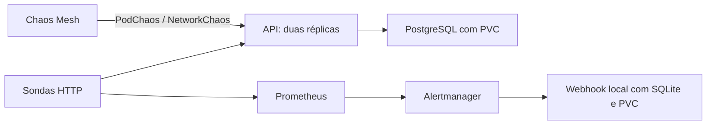

# Chaos Mesh na aplicação de notas

[English](README.en.md)

Quis testar se os alertas ajudam a entender uma falha enquanto ela está acontecendo. Neste lab, o Chaos Mesh derruba Pods e muda a rede entre a API de notas e o PostgreSQL. Prometheus observa as sondas HTTP, o Alertmanager avisa uma caixa de entrada local e o teste acompanha a recuperação e os dados.

A aplicação vem do [docker-lab](https://github.com/tommmdl/docker-lab), com as imagens Alpine já adotadas no portfólio. Ela ganha um banco e volumes próprios em `chaos-demo`. Os componentes de observação ficam em `chaos-observe`, e o Chaos Mesh em `chaos-system`. Os outros labs continuam com suas configurações e dados.



## Os experimentos

| Experimento | Pergunta | O que observar |
| --- | --- | --- |
| Remover uma réplica da API | A outra mantém o serviço? | Respostas HTTP, novo UID do Pod e ausência de alerta de queda sustentada. |
| Atrasar API → banco em 100 ms por pacote | O alerta distingue lentidão de indisponibilidade? | Tempo da sonda acima de 400 ms, sondas bem-sucedidas e alerta `ChaosApiSlow`. |
| Bloquear API → banco por 60 s | A API continua viva quando perde a dependência? | Liveness saudável, readiness falhando e alerta `ChaosDatabaseUnavailable`. |
| Tornar as duas réplicas da API indisponíveis | A queda aparece no caminho inteiro de alerta? | Sondas falhando, `ChaosApiUnavailable`, webhook firing e depois resolved. |
| Remover o Pod do PostgreSQL | O banco volta com as escritas já confirmadas? | Pod novo, mesmo PVC, dados iguais e uma nova escrita pela API. |

Os experimentos de rede e de indisponibilidade têm duração limitada. O teste cancela alguns pelo caminho normal de remoção e deixa a partição de rede expirar para conferir a recuperação por tempo. O controlador precisa continuar disponível para executar essa recuperação.

Na primeira execução local, a remoção abrupta de uma réplica deixou **2 falhas de conexão em 16 amostras**. As outras 14 responderam 200 e não houve alerta de queda sustentada. Esse resultado está mantido no relatório inicial: a recuperação das réplicas não significou ausência de erros transitórios.

## Rodar

Use Linux ou WSL em x86_64, Docker, Python 3 e o cluster kind `devops-notes` do [kubernetes-lab](https://github.com/tommmdl/kubernetes-lab). Os repositórios ficam lado a lado. O script usa o kubeconfig e o kubectl daquele lab, com contexto explícito. Para usar outros caminhos, configure `KUBECTL` e `KUBECONFIG_CHAOS`.

O kernel precisa do módulo `sch_netem`. Neste computador ele foi carregado pelo root do WSL. Em um Linux com sudo, o comando é:

```bash
sudo modprobe sch_netem
python3 scripts/lab.py up
python3 tests/verify.py
python3 scripts/access.py
```

Helm e o chart têm versão e checksum fixados em [config/tools.json](config/tools.json). O script baixa esses arquivos e verifica os hashes antes da instalação. Não há dependências Python extras. O CI cria um cluster descartável e usa o mesmo instalador e os mesmos testes.

Com `access.py` aberto:

- [Aplicação — localhost:8024](http://localhost:8024/)
- [Prometheus — localhost:8025](http://localhost:8025/)
- [Alertmanager — localhost:8026](http://localhost:8026/)
- [Notificações recebidas — localhost:8027/api/events](http://localhost:8027/api/events)

O acesso local acompanha os Services pelos NodePorts e continua funcionando depois da troca de Pods. Durante uma falha ele pode devolver erro. Escritas com erro não são repetidas automaticamente; confira o resultado antes de tentar novamente.

## Explorar uma falha de cada vez

```bash
python3 scripts/experiment.py apply 02-database-delay
python3 scripts/experiment.py remove 02-database-delay
python3 scripts/lab.py status
```

Os arquivos em [experiments](experiments) são manifestos JSON aceitos pelo Kubernetes. O executor confere namespace, seletores, direção e duração antes de aplicá-los. Ele recusa seletores fora da aplicação do lab e não substitui um experimento existente. O teste completo e os comandos de alteração compartilham um lock local.

Para remover as falhas criadas por este lab:

```bash
python3 scripts/lab.py recover
```

Esse comando mantém a aplicação, o banco e os volumes. O [procedimento de recuperação](docs/runbook.md) explica como conferir a limpeza, o que fazer se o controlador parar e como encerrar o ambiente.

## Como os alertas são conferidos

As regras consultam as sondas de liveness e readiness. O serviço de sondas publica endereços de Pods sem prontidão para permitir observar o motivo da falha; o serviço usado pela aplicação respeita readiness. O banco usa um Service headless para a conexão ir ao IP do Pod selecionado pelo experimento de rede.

A regra de dependência indica que a API está viva, mas não consegue atender uma requisição que usa o banco. Neste teste o bloqueio é conhecido e direcionado ao PostgreSQL. Em uma investigação real, esse sinal também exigiria conferir outras dependências e os logs.

O teste espera o alerta aparecer no Prometheus, encontra a mensagem firing na caixa local e compara seu fingerprint com a mensagem resolved. Reinicia o receptor para conferir a persistência das notificações. Antes e depois das falhas, compara todas as linhas, IDs e timestamps e a identidade do PVC do PostgreSQL. As notas de teste ficam no banco para inspeção; credenciais e valores de referência ficam em `.local`, fora do Git.

## Reduzir as falhas ao remover uma réplica

A investigação agora compara remoção abrupta e remoção com prazo, espera de drenagem e novas tentativas apenas para GET. O [relato em português](docs/connections.md) mostra a comparação sob tráfego, os erros que continuaram acontecendo e o teste de POST com resposta perdida. Foram 70 verificações locais e 70 no CI. A remoção com prazo caiu de 7/1.592 para 0/1.645 falhas diretas localmente, e de 10/1.172 para 1/1.425 no CI: ainda houve falha com drenagem. O experimento original com prazo zero e os resultados anteriores continuam disponíveis.

## O timeout que restou no CI

A [continuação da investigação](docs/connection-timeout.md) separa estabelecimento TCP e resposta HTTP, compara o acesso com limites de conexão de três segundos e 500 ms e exercita um descarte real de SYN. Passaram 90 verificações locais e 90 no CI. A captura local confirmou RST durante leitura de cabeçalhos e RST após SYN em controles abruptos, sem drops na captura. O CI 39409055794 passou em 102 verificações: 8 remoções graciosas sem falha direta e 7 falhas em 1.390 requisições nos cortes abruptos. A captura encontrou seis RST depois do handshake e um RST após SYN, sem drops. O primeiro CI, que parou antes da captura, também ficou registrado. A causa do timeout histórico na remoção graciosa continua sem confirmação.

## De onde vêm os RST

A [investigação com o kernel](docs/rst-origin.md) identificou a origem dos RST reproduzidos: a pilha TCP dos Pods da API. A análise automática final atribuiu 15 pacotes: três no fechamento do listener em contexto Gunicorn e 12 por `NO_SOCKET`, com correspondência antes/depois da NAT, no veth e no stack do kernel. A coleta passou em 42 verificações, mas o workflow final falhou numa checagem posterior de substituição de Pod. Essa falha, o primeiro run com 115 verificações aprovadas e as falhas recuperadas continuam publicados. O timeout histórico de seis segundos permanece sem causa confirmada.

## A checagem de substituição de Pod

A [investigação da checagem](docs/pod-replacement.md) reproduz uma corrida entre duas leituras do Kubernetes e mostra a correção com uma única observação de prontidão e identidade. O controle usa uma remoção real com Chaos Mesh; os resultados e o CI anterior que falhou continuam disponíveis.

## Resultados e limites

Passaram 43 verificações locais e as mesmas 43 no CI. Os [resultados](docs/validation.md) e os [relatórios dos experimentos](evidence) registram o que foi executado. A execução inicial teve auxílio do assistente; repetir os cenários e explicar as decisões faz parte do estudo.

O Chaos Mesh usa acesso privilegiado ao runtime dos nós kind para injetar falhas. O controlador tem permissão de alteração de Pods em `chaos-demo`; a filtragem de namespace e os seletores também restringem os alvos. Há permissões globais de leitura para descoberta. Esses controles reduzem o alcance dos experimentos, mas o daemon privilegiado exige um ambiente de estudo confiável. O dashboard não faz parte desta instalação.

Os limiares e tempos foram encurtados para o laboratório. As amostras de HTTP não medem disponibilidade contínua, e duas réplicas no mesmo host não comprovam tolerância à perda da máquina. Os alertas chegam a um receptor local; não foi testada entrega a um serviço externo de plantão. Replicação, backup e recuperação entre clusters continuam nos outros labs do portfólio.

As imagens estão presas por digest em [config/images.json](config/images.json). As análises das imagens da API e do banco continuam visíveis no [security-lab](https://github.com/tommmdl/security-lab); este exercício não substitui um novo scan das imagens de Chaos Mesh e observação.

Referências: [instalação com Helm](https://chaos-mesh.org/docs/production-installation-using-helm/), [filtragem de namespaces](https://chaos-mesh.org/docs/configure-enabled-namespace/), [PodChaos](https://chaos-mesh.org/docs/simulate-pod-chaos-on-kubernetes/) e [NetworkChaos](https://chaos-mesh.org/docs/simulate-network-chaos-on-kubernetes/).
