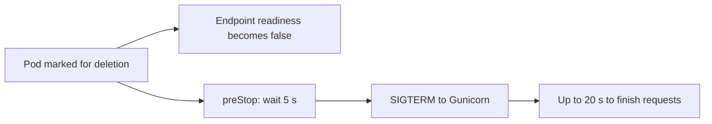

# What happened when a replica left

[Português](connections.md) · [Back to the lab](../README.en.md)

The first experiment's connection failures deserved closer inspection. I repeated removals under traffic, retained each connection error, and followed Pods, EndpointSlices and Gunicorn signals. The application and its image stayed the same. Changes affect Pod shutdown and local HTTP access.

## Diagnosis

Observed errors were `ConnectionResetError`, `ConnectionRefusedError` and `TimeoutError`, without an HTTP response. Traffic uses the numeric NodePort IP and `/healthz`, which does not query PostgreSQL. Before adding a draining wait, Gunicorn began shutting down about 15–54 ms after the watch observed Pod deletion during removals with a grace period.

EndpointSlices change during deletion too: an endpoint can become `terminating` with `ready=false` before disappearing. Kubernetes and traffic forwarding do not update everything simultaneously. The records are consistent with a window between application shutdown and routing convergence. These are watch/log receipt times; I did not capture packets or measure when each node programmed its rules. Individual timeouts cannot be assigned to an exact stage of that window.

With the five-second wait, the termination signal appeared about 5.01–5.02 s after observed deletion in the four local graceful-removal trials. The service could withdraw the endpoint while the API was still answering.



Both branches progress asynchronously. The wait gives traffic updates time to propagate; it does not itself confirm that every load balancer has converged.

## Changes

The API now has `terminationGracePeriodSeconds: 30`, `preStop.sleep.seconds: 5` and `GUNICORN_CMD_ARGS=--graceful-timeout 20`. Its budget includes the wait and worker shutdown. The kubelet performs the sleep, so it also works while the unavailability experiment temporarily changes the container image. This was validated on this lab's Kubernetes 1.37. Rollouts use `maxUnavailable: 0`, `maxSurge: 1` and two seconds of readiness before a replica is considered available.

Original experiment `01-api-pod-kill` retains `gracePeriod: 0`, which skips `preStop`. Observing SIGTERM in a log does not mean a draining interval was allowed. New experiment `06-api-graceful-removal` allows 30 seconds. Both cases remain separate in testing.

API access at localhost:8024 now gives GET up to three attempts on transport failures, with 50 and 100 ms waits and a configured four-second budget. Current GET routes are read-only. An HTTP response, including 4xx or 5xx, returns without another attempt. POST and DELETE retain a single attempt.

`X-Lab-Upstream-Attempts` and `X-Lab-Transport-Failures` expose what happened, and the access process logs transport failures. Prometheus probes still access Pods through the probe Service without these retries. Application failure alerts continue to be tested through the original path.

## Local comparison

Four trials per combination produced **16 real Chaos Mesh removals**. Each trial ran direct NodePort traffic and traffic through the retrying GET gateway concurrently. Each path uses two clients, with a minimum 50 ms interval per client.

| Configuration | Removal | Failures / direct requests | Failures / reads through retrying access | Transport failures inside that access |
| --- | --- | --- | --- | --- |
| No wait | Zero grace | 23 / 1,809 | 3 / 1,940 | 22 |
| No wait | 30 s grace | 7 / 1,592 | 0 / 1,760 | 4 |
| 5 s wait | Zero grace | 5 / 1,654 | 0 / 1,653 | 2 |
| 5 s wait | 30 s grace | 0 / 1,645 | 0 / 1,645 | 0 |

Graceful removal went from seven failed direct requests to none in this run's samples. Abrupt removal still produced five direct failures with the new configuration. The difference between 23 and five across the abrupt-removal groups does not demonstrate a `preStop` benefit: that hook is skipped and trials vary.

GET retries reduced client-visible errors in the observed cases, but the first group still had three failed reads after attempts were exhausted. Internal failures and attempt counts remain in the report. Zero failures in a sample does not establish an availability guarantee.

Paths have different denominators. Requests waiting for a timeout occupy a client longer; retries change load and latency too. Requests are not paired against the same backend. Profiles ran in a fixed order, removal selected a random replica, and testing used a shared study host. This is a finite operational comparison without a production SLO estimate or statistical significance claim.

## Writes and retry limits

A real HTTP test let the API acknowledge a POST and discarded the response in a local intermediary. The gateway returned 502, made one attempt and found one committed note. The API still has no idempotency key: reconcile a failed write before retrying it.

Four other protocol tests checked GET exhaustion at three attempts, direct forwarding of HTTP 503, no DELETE retry and bounded waiting for a slow response. They use a real local HTTP server that closes connections or delays replies. The POST test queries the lab's actual application and PostgreSQL.

## Recovery regression

The complete local run passed **70 checks**: 43 original chaos/recovery checks, 23 replica-removal and data-safety checks, and four HTTP protocol checks. The [new regression report](../evidence/verification.json) took 191.68 s and ended with two ready API Pods, one ready PostgreSQL Pod, seven notes, the same PVC and no active alerts. The separate comparison took 246.89 s. “Passed” means recovery, data preservation and retry policy assertions passed; it does not require every traffic sample to succeed.

The [final state](../evidence/resilience-final-state.json) confirms active draining, the updated gateway headers and no remaining experiments. Backup, recovery and failover applications still have eight, seven and 14 notes respectively. The [first release report](../evidence/chaos-first-release-verification.json) is retained separately.

## Independent GitHub run

[Workflow 39331748715](https://github.com/tommmdl/chaos-lab/actions/runs/39331748715) passed the same **70 checks** in a fresh runner cluster. The original regression took 188.67 s and the comparison took 180.29 s. [Run metadata](../evidence/resilience-ci-run.json) identifies the tested commit; complete results are retained for the [comparison](../evidence/resilience-ci.json), [regression](../evidence/resilience-ci-chaos-verification.json) and [HTTP protocol](../evidence/resilience-ci-access-policy.json).

| Configuration | Removal | Failures / direct requests | Failures / reads through retrying access | Transport failures inside that access |
| --- | --- | --- | --- | --- |
| No wait | Zero grace | 1 / 1,468 | 0 / 1,456 | 5 |
| No wait | 30 s grace | 10 / 1,172 | 1 / 1,252 | 14 |
| 5 s wait | Zero grace | 3 / 1,218 | 0 / 1,218 | 1 |
| 5 s wait | 30 s grace | 1 / 1,425 | 0 / 1,484 | 1 |

**One direct request still failed during graceful removal with draining in CI.** The result fell from 10/1,172 to 1/1,425, without reaching zero. Retrying access recovered its single transport failure in that profile; the last column retains it. Without waiting and with a grace period, one read still failed after retries. The [CI summary](../evidence/resilience-ci-summary.json) retains counts and denominators. Both environments support the observed reduction without demonstrating elimination or making abrupt failure safe for writes.

## Reproduce and inspect evidence

```bash
python3 tests/resilience.py --rounds 4
python3 tests/access_policy.py
python3 tests/verify.py
```

The comparator switches profiles, performs removals and leaves draining enabled at the end. It refuses existing experiments and shares the other commands' lock. It checks original notes/timestamps and PVC UID, plus other labs' workloads, images and PVCs. The POST test adds an identified note to prove a single commit; it remains for inspection.

The [local summary](../evidence/resilience-summary.json) is easier to browse. The [complete record](../evidence/resilience.json) retains every sample, error, attempt, Pod/EndpointSlice watch and experiment event. The [initial diagnosis](../evidence/resilience-initial-diagnosis.json) preserves eight earlier trials before adopting native sleep; that collection was stopped in a controlled way to change the hook implementation. It is not the final complete run.

[Protocol checks](../evidence/access-policy.json) retain measured retry boundaries. Original documentation and failures remain in [validation.en.md](validation.en.md). Reports omit passwords and private reference database values.

Restart `python3 scripts/access.py` after updating code to use the new browser access policy. `curl -i http://localhost:8024/healthz` shows attempt headers. To disable retries alone, set `get_max_attempts` to 1 in `config/api-resilience.json` and restart that process. Kubernetes services and probes remain available directly.

The five-second wait and 20-second shutdown window are choices for this environment. Long connections, ingress, external load balancers, different load and node loss require further testing. These measures do not guarantee delivery of a write during abrupt failure.

References: [Pod/endpoint termination](https://kubernetes.io/docs/tutorials/services/pods-and-endpoint-termination-flow/), [container lifecycle hooks](https://kubernetes.io/docs/concepts/containers/container-lifecycle-hooks/) and [Gunicorn signals](https://gunicorn.org/signals/).
