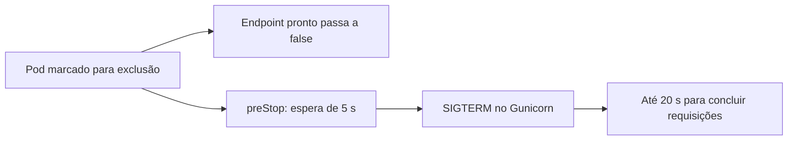

# O que acontecia quando uma réplica saía

[English](connections.en.md) · [Voltar ao lab](../README.md)

As duas falhas da primeira experiência mereciam mais do que aumentar o número de réplicas. Repeti a remoção sob tráfego, guardei o erro de cada conexão e acompanhei Pods, EndpointSlices e os sinais do Gunicorn. A API e a imagem continuaram iguais. As mudanças ficaram no encerramento do Pod e no acesso HTTP local.

## O diagnóstico

As falhas observadas foram `ConnectionResetError`, `ConnectionRefusedError` e `TimeoutError`, sem resposta HTTP. O tráfego usa o IP numérico do NodePort e `/healthz`, que não consulta o banco. Nos registros da remoção com prazo, o Gunicorn começava a encerrar cerca de 15–54 ms depois de o watch observar a exclusão do Pod, quando ainda não havia uma espera de drenagem.

Os EndpointSlices também mudam durante a exclusão: o endpoint pode aparecer como `terminating`, com `ready=false`, antes de desaparecer. O Kubernetes e o encaminhamento de tráfego não atualizam tudo no mesmo instante. Os registros são compatíveis com uma janela entre a parada da API e a convergência do roteamento. São horários de recebimento de watches e logs; não capturei pacotes nem medi quando cada nó programou suas regras. Não atribuo cada timeout a uma etapa exata dessa janela.

Com a espera de cinco segundos, o sinal de término apareceu cerca de 5,01–5,02 s depois da exclusão observada nas quatro rodadas locais com prazo. O serviço pôde retirar o endpoint do tráfego enquanto a API ainda respondia.



As duas ramificações avançam de forma assíncrona. A espera dá margem à atualização do tráfego; não confirma, sozinha, que todos os balanceadores já convergiram.

## O que mudou

A API ficou com `terminationGracePeriodSeconds: 30`, `preStop.sleep.seconds: 5` e `GUNICORN_CMD_ARGS=--graceful-timeout 20`. O orçamento inclui a espera e o encerramento dos workers. O sleep é executado pelo kubelet e funciona também durante a troca temporária da imagem pelo experimento de indisponibilidade. Foi validado no Kubernetes 1.37 deste lab. O rollout usa `maxUnavailable: 0`, `maxSurge: 1` e dois segundos de prontidão antes de considerar uma réplica disponível.

O experimento original `01-api-pod-kill` continua com `gracePeriod: 0`. Esse valor ignora o `preStop`; receber SIGTERM em algum registro não significa que houve tempo de drenagem. O novo `06-api-graceful-removal` concede 30 segundos. Os dois casos permanecem separados nos testes.

No acesso da API em localhost:8024, GET ganhou até três tentativas para falhas de transporte, com esperas de 50 e 100 ms e orçamento configurado de quatro segundos. As rotas GET atuais são de leitura. Uma resposta HTTP, inclusive 4xx ou 5xx, volta ao cliente sem nova tentativa. POST e DELETE continuam com uma única tentativa.

Os cabeçalhos `X-Lab-Upstream-Attempts` e `X-Lab-Transport-Failures` mostram o que aconteceu. O processo de acesso também registra falhas de transporte no log. As sondas do Prometheus continuam acessando os Pods pelo serviço de sondas, sem passar por essa repetição de GET. Os avisos de falha da aplicação continuam sendo testados pelo caminho original.

## Comparação local

Foram quatro rodadas por combinação, totalizando **16 remoções reais pelo Chaos Mesh**. Cada rodada manteve tráfego direto no NodePort e tráfego pelo acesso com GET repetível ao mesmo tempo. São dois clientes por caminho, com intervalo mínimo de 50 ms por cliente.

| Configuração | Remoção | Falhas / requisições diretas | Falhas / leituras pelo acesso com tentativas | Falhas de transporte vistas dentro desse acesso |
| --- | --- | --- | --- | --- |
| Sem espera | Prazo zero | 23 / 1.809 | 3 / 1.940 | 22 |
| Sem espera | Prazo de 30 s | 7 / 1.592 | 0 / 1.760 | 4 |
| Espera de 5 s | Prazo zero | 5 / 1.654 | 0 / 1.653 | 2 |
| Espera de 5 s | Prazo de 30 s | 0 / 1.645 | 0 / 1.645 | 0 |

A remoção com prazo passou de sete falhas para nenhuma nas amostras diretas dessa execução. O corte abrupto ainda teve cinco falhas diretas com a configuração nova. A diferença entre 23 e cinco nos dois conjuntos de cortes abruptos não demonstra benefício do `preStop`: o hook é ignorado nesse caso e as rodadas variam.

A repetição de GET reduziu o erro entregue ao cliente nos casos observados, mas o primeiro conjunto ainda teve três leituras que falharam depois das tentativas. As falhas internas e o número de tentativas continuam no relatório. Zero falhas numa amostra não estabelece garantia de disponibilidade.

Os números dos dois caminhos têm denominadores diferentes. Requisições que esperam timeout ocupam o cliente por mais tempo; novas tentativas também mudam a carga e a latência. As requisições não são pareadas no mesmo backend. A ordem dos perfis foi fixa, a remoção escolheu uma réplica aleatória e os testes ocorreram no mesmo host de estudo. Esta é uma comparação operacional finita, sem estimativa de SLO ou significância estatística para produção.

## Escritas e limites das novas tentativas

Um teste com HTTP real deixou a API confirmar um POST e descartou a resposta num intermediário local. O acesso devolveu 502, fez uma única tentativa e encontrou uma única nota gravada. A API continua sem chave de idempotência: uma falha de escrita exige conferir o resultado antes de repetir.

Outros quatro testes de protocolo conferiram esgotamento das três tentativas de GET, retorno direto de HTTP 503, ausência de repetição de DELETE e término da espera com uma resposta lenta. Eles usam um servidor HTTP local que fecha conexões ou atrasa a resposta. O teste do POST consulta a aplicação e o PostgreSQL reais do lab.

## Regressão de recuperação

A execução local completa passou em **70 verificações**: 43 dos experimentos originais e recuperação, 23 da comparação de réplicas e segurança dos dados e quatro de protocolo HTTP. A [nova regressão](../evidence/verification.json) levou 191,68 s e terminou com duas APIs prontas, um PostgreSQL pronto, sete notas, o mesmo PVC e nenhum alerta ativo. A comparação separada levou 246,89 s. “Passou” significa que as asserções de recuperação, preservação dos dados e política de tentativas foram atendidas; não exige que toda amostra de tráfego tenha sucesso.

O [estado final](../evidence/resilience-final-state.json) confirma a drenagem ativa, os cabeçalhos do acesso atualizado e nenhum experimento restante. As aplicações de backup, recuperação e failover continuam com oito, sete e 14 notas, respectivamente. O [relatório da primeira entrega](../evidence/chaos-first-release-verification.json) foi preservado separadamente.

## Execução independente no GitHub

O [workflow 39331748715](https://github.com/tommmdl/chaos-lab/actions/runs/39331748715) passou nas mesmas **70 verificações**, em um cluster novo no runner. A regressão original levou 188,67 s e a comparação levou 180,29 s. O [registro da execução](../evidence/resilience-ci-run.json) identifica o commit testado; os resultados completos estão em [comparação](../evidence/resilience-ci.json), [regressão](../evidence/resilience-ci-chaos-verification.json) e [protocolo HTTP](../evidence/resilience-ci-access-policy.json).

| Configuração | Remoção | Falhas / requisições diretas | Falhas / leituras pelo acesso com tentativas | Falhas de transporte dentro desse acesso |
| --- | --- | --- | --- | --- |
| Sem espera | Prazo zero | 1 / 1.468 | 0 / 1.456 | 5 |
| Sem espera | Prazo de 30 s | 10 / 1.172 | 1 / 1.252 | 14 |
| Espera de 5 s | Prazo zero | 3 / 1.218 | 0 / 1.218 | 1 |
| Espera de 5 s | Prazo de 30 s | 1 / 1.425 | 0 / 1.484 | 1 |

**Ainda houve uma falha direta na remoção com prazo e drenagem no CI.** O resultado caiu de 10/1.172 para 1/1.425, mas não chegou a zero. O acesso com tentativas recuperou sua única falha de transporte nesse perfil; isso continua visível na última coluna. No perfil sem espera e com prazo, uma leitura falhou mesmo com novas tentativas. O [resumo do CI](../evidence/resilience-ci-summary.json) mantém contagens e denominadores. Os dois ambientes sustentam a redução observada, sem demonstrar eliminação das falhas nem tornar o corte abrupto seguro para escritas.

## Reproduzir e conferir os registros

```bash
python3 tests/resilience.py --rounds 4
python3 tests/access_policy.py
python3 tests/verify.py
```

O comparador alterna os perfis, executa as remoções e deixa a configuração com drenagem ativa no final. Ele recusa experimentos já existentes e compartilha o lock dos outros comandos. As notas e timestamps originais e o UID do PVC são conferidos, assim como workloads, imagens e PVCs dos outros labs. O teste de POST acrescenta uma nota identificada para provar a gravação única; ela fica para inspeção.

O [resumo local](../evidence/resilience-summary.json) facilita a leitura. O [registro completo](../evidence/resilience.json) contém cada amostra, erros, tentativas, watches de Pods/EndpointSlices e eventos dos experimentos. O [diagnóstico inicial](../evidence/resilience-initial-diagnosis.json) preserva as oito rodadas anteriores à adoção do sleep nativo; aquela coleta foi interrompida de forma controlada para trocar a implementação do hook. Ela não representa a execução final completa.

As [verificações de protocolo](../evidence/access-policy.json) registram os limites medidos das tentativas. A documentação inicial e suas falhas continuam em [validation.md](validation.md). Os relatórios não incluem senhas nem os valores usados como referência privada da base.

Para conferir o acesso no navegador, reinicie `python3 scripts/access.py` depois de atualizar o código. Um `curl -i http://localhost:8024/healthz` mostra os cabeçalhos de tentativas. Para desativar apenas as novas tentativas, configure `get_max_attempts` como 1 em `config/api-resilience.json` e reinicie esse processo. O serviço Kubernetes e as sondas continuam disponíveis pelo caminho direto.

Cinco segundos de espera e 20 segundos de encerramento são escolhas deste ambiente. Conexões longas, ingress, balanceadores externos, outra carga e perda de nó precisam de novos testes. Nenhuma dessas medidas garante entrega de uma escrita durante uma interrupção abrupta.

Referências: [término de Pods e endpoints](https://kubernetes.io/docs/tutorials/services/pods-and-endpoint-termination-flow/), [hooks de ciclo de vida](https://kubernetes.io/docs/concepts/containers/container-lifecycle-hooks/) e [sinais do Gunicorn](https://gunicorn.org/signals/).
